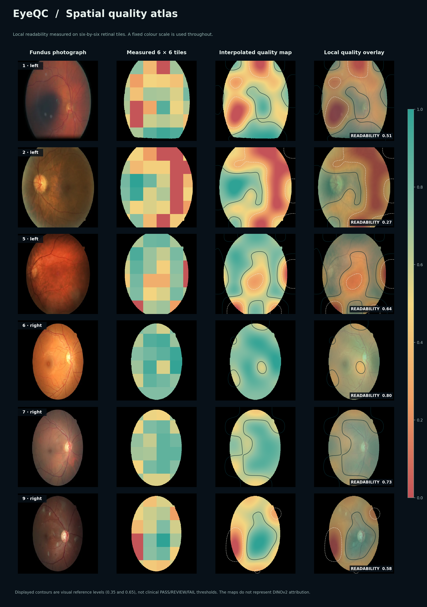
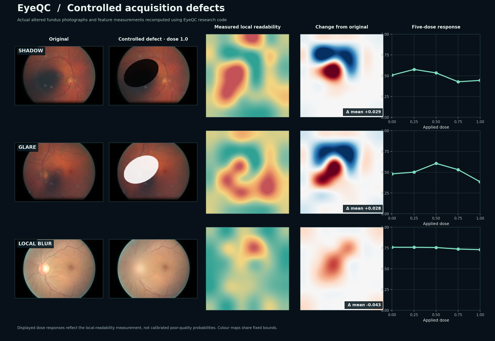

# EyeQC

**Retinal image quality, made visible.**

EyeQC is an open research framework for assessing technical quality in color fundus photographs. The published model combines ten interpretable image-quality measurements with a frozen 768-dimensional DINOv2 visual embedding, followed by calibrated logistic regression. The research tools include locally measured quality maps, controlled acquisition degradations, and optional vessel and FLAIR analyses.

**Use the interactive tool:** [EyeQC on Hugging Face Spaces](https://huggingface.co/spaces/Dharini24/EyeQC)  
**Research code, results, and methods:** this repository.



## What you can do in the Space

The live app brings these analyses together on one page. Upload a JPEG, PNG, TIFF or WebP image; calculate the ten quality measurements and inspect the measured six-by-six local-readability map. Browse examples with calibrated color scales, explore nine controlled acquisition defects and five severities, compare dose-response measurements, and export analysis results. Run the separate **RRWNet vessel model** and **FLAIR image–text comparison** on the same photograph when their public pretrained weights are available. They do not modify EyeQC's published quality score.

The Space runs the same Python feature extractor included here. It does not serve a second linked website. It uses a Hugging Face Docker Space so the Python backend and the interface live under one address. The site does **not** assert that browser previews, FLAIR prompts, or vessel density are validated substitutes for the published EyeQC classifier.

## Evidence from the study

| Cohort | Images | AUROC |
|---|---:|---:|
| EyeQ-test (held-out, same source) | 16,249 | 0.984 |
| DRIMDB | 194 | 1.000 |
| FQS | 2,246 | 0.897 |
| MSHF-CFP | 802 | 0.939 |
| DeepDRiD | 1,600 | 0.780 |

The validation included **21,091 photographs**. Reader agreement, model ablations, published baselines, calibration, degradation responses, localization performance, and acquisition-level quality ranking are reported in `research/data` and the manuscript. The model's fixed PASS thresholds transferred unevenly; the DeepDRiD PASS negative predictive value was 64.0%. The app is for research, not clinical image acceptance.



## Research repository

| Directory | Contents |
|---|---|
| `eyeqc/` | Original interpretable feature extraction and controlled degradation code |
| `eyeqc_runtime/` | Frozen trained-head contract and isolated experimental encoder interface |
| `eyeqc_vessel/` | RRWNet artery, vein, and vessel-structure inference |
| `eyeqc_flair/` | FLAIR vision–language model comparisons |
| `portal/` | Python API serving the same unified website used by the Space |
| `docs/` | Front-end source, photographs, measured spatial maps, and visualized research results (served by the Space) |
| `research/code/` | Study analysis and validation scripts |
| `research/data/` | Selected aggregate experiment summaries and tables |
| `research/figures/` | Figures computed from supplied retinal photographs and quality code |
| `models/` | Frozen model contracts and published thresholds |
| `space/` | Hugging Face Docker Space metadata and Dockerfile |
| `scripts/package_space.py` | Exports a standalone Space deployment without duplicating study records |
| `tests/` | Automated Python and API checks |

## Run the research API and website locally

```bash
python -m venv .venv
source .venv/bin/activate  # Windows: .venv\\Scripts\\activate
pip install -r requirements.txt
uvicorn portal.app:app --host 127.0.0.1 --port 7860
# Open http://127.0.0.1:7860/
```

Core measurement, spatial-map, and degradation functions work with the base dependencies. To run the optional RRWNet/FLAIR pretrained models, install the optional requirements and FLAIR implementation:

```bash
pip install -r requirements-optional.txt
pip install git+https://github.com/jusiro/FLAIR.git
```

FLAIR weights are loaded from `jusiro2/FLAIR` and RRWNet weights from `j-morano/rrwnet-rite` on first use. Download size, license, CPU memory and startup time depend on the external model repositories. Pretrained-model downloads and complete Docker builds were not validated in this offline build.

## Publish the Hugging Face tool

The GitHub repository contains the complete research release. Deployment is to **Hugging Face Spaces**, not GitHub Pages. See [HUGGINGFACE_DEPLOY.md](HUGGINGFACE_DEPLOY.md), or export the standalone Space:

```bash
python scripts/package_space.py --output ../EyeQC_hf_space
```

The export includes its own root `README.md` with `sdk: docker`, its Dockerfile, source, model contracts, and all web assets. Push its **contents** to `Dharini24/EyeQC`. No GitHub Pages workflow is needed.

## What the spatial maps mean

The heatmaps in this repository are **interpolated measurements from a six-by-six grid of local image readability**, made using the supplied research code and sample photographs. They are not independent expert-labelled masks, per-pixel clinical annotations or DINOv2 attribution. The nine degradation experiments show responses of these *local features* to controlled changes. Published hybrid-classifier dose-response statistics are from the archived model experiments, not recomputed by the interactive browser.

## Reproducing the analysis

```bash
pip install -r requirements.txt pytest
python scripts/check_pages.py
python -m pytest -q tests/
```

The reference research scripts and aggregate numerical results are in `research/`. Running all training or validation experiments requires the original datasets under their respective access agreements and the full preprocessing code used for the frozen DINOv2 embeddings. See [MODEL_VALIDATION.md](MODEL_VALIDATION.md) for the current model-parity limitation.

## Research use, privacy, and rights

This code and Space are research demonstrations, not medical devices. Image-quality thresholds should not guide patient care without separate clinical validation. The app processes uploads in request memory; Hugging Face hosting is not a clinical privacy assurance. Only publicly redistributable, appropriately de-identified images should be included in the Space gallery. Verify rights to the supplied example photographs before deployment. No image or checkpoint licenses are transferred by this repository.

## Citation

The EyeQC manuscript is under preparation. The repository includes `CITATION.cff`; update the publication metadata, DOI, and exact release tag on publication.
