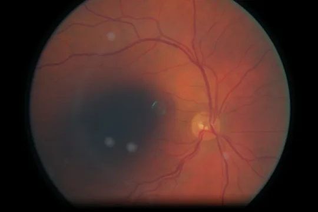

# EyeQC

**Retinal image quality, made visible.**

EyeQC is a research framework for assessing the technical quality of retinal fundus photographs. The study evaluates a 778-feature classifier (ten interpretable measurements plus a frozen 768-dimensional DINOv2 representation), a calibrated probability of poor image quality, and local quality measurements. The website makes the measurements and results easier to inspect without treating an image score as a clinical decision.



### Open the website

Once GitHub Pages is enabled: **https://rdharini2001.github.io/EyeQC/**

The `docs/` folder is a **self-contained website**. It does not need a Node build, a database or a Python server. It includes:

- A specimen explorer with eleven real user-supplied retinal photographs, original six-by-six measured readability maps, inspectable tiles, and all ten extracted feature values.
- An acquisition-degradation laboratory with nine transformations, five severity settings and recalculated feature curves. All displayed examples were made by running `eyeqc.experiments.apply_degradation()` and `eyeqc.core.extract_features()` on the source photographs.
- Interactive displays of the reported five-cohort validation results, baseline AUROCs, reader agreement and within-eye image quality findings.
- Optional file upload **for a browser-only photographic preview**. The upload stays in the browser; it is *not* the validated EyeQC model and does not provide a calibrated PASS/REVIEW/FAIL score.

**The public website does not pretend to perform full model inference.** GitHub Pages cannot run Python/PyTorch. The distributed original code also lacks the published DINOv2 preprocessing implementation necessary to reproduce the exact trained embeddings, so the server's candidate reconstruction is off by default. See `docs/DEPLOY.md` and `MODEL_VALIDATION.md`.

## Project map

| Location | Contains |
|---|---|
| `docs/` | GitHub Pages site; authored HTML/CSS/JavaScript, real static measurements and photographs |
| `scripts/build_assets.py` | Rebuilds measured gallery and degradation outputs from explicitly approved image files using the original EyeQC feature and degradation code |
| `scripts/check_pages.py` | Checks that every referenced map, image and result file is present |
| `eyeqc/` | Original research feature extraction and degradation code |
| `models/` | Supplied frozen model contracts and checksums |
| `research/code/` | Original development, validation and reader-analysis scripts |
| `research/data/` | Selected aggregate CSV outputs (not protected image-level records or large embedding caches) |
| `eyeqc_flair/`, `eyeqc_vessel/` | Optional experimental modules, separate from the evaluated EyeQC hybrid model |
| `portal/` | Optional FastAPI server providing Python feature extraction and research endpoints |
| `.github/workflows/pages.yml` | GitHub Actions job to validate and publish `docs/` |

## Local preview

```bash
# Run from the repository root
python -m http.server 8000 --directory docs
# Visit http://localhost:8000/
```

Or publish `docs/` through GitHub Pages. `file://` is not supported because modern browsers block JSON fetching from local files.

## Rebuilding the real visuals

Only use photographs with permission for public redistribution:

```bash
pip install -r requirements.txt
python scripts/build_assets.py --images /path/to/approved/retinal_photographs
python scripts/check_pages.py
```

**What the maps mean.** EyeQC's Python extractor measures retinal local readability on a six-by-six tile grid. The PNG heatmaps interpolate the tile values for display. They are *not* ground-truth segmentations, pixel-level clinical annotations, or DINOv2 attribution. Green indicates relatively better measured readability, red lower measured readability, using a fixed shared 0–1 scale.

**What the curves mean.** In the degradation laboratory, the features shown are rerun on the altered photograph. They are not predicted probabilities from the trained 778-feature model. For published monotonicity and localization statistics from the actual trained classifier, see the archived results and manuscript.

## Research numbers at a glance

The manuscript reports 21,091 evaluation photographs including 16,249 held-out EyeQ-test photographs and 4,842 from DRIMDB, FQS, MSHF-CFP and DeepDRiD. AUROCs were 0.984, 1.000, 0.897, 0.939 and 0.780, respectively. EyeQC–reader weighted κ ranged from 0.702 to 0.777 in an 80-image study. Median CPU end-to-end latency was 208 ms. These are **historical research evaluation results**, not metrics recalculated when viewing the website.

DeepDRiD PASS negative predictive value was 64.0% under the fixed development thresholds. This is why the site does not autonomously recommend accepting or rejecting a clinical photograph.

## Optional research services

```bash
pip install -r requirements.txt
uvicorn portal.app:app --host 127.0.0.1 --port 8001
```

The FastAPI service computes the Python ten-feature extractor, local maps, batch analysis and controlled degradation for uploaded photographs. FLAIR and vessel outputs require their optional dependencies and model weights. **Published model equivalence is not yet established for the available candidate DINOv2 encoder.** Avoid enabling it for public clinical use.

## Publish

See [the step-by-step GitHub Pages guide](docs/DEPLOY.md). This repository supports the simplest path, **Settings → Pages → Deploy from branch → `main` → `/docs`**, as well as GitHub Actions. Choose **one** Pages source, not both.

## Ethics, intended use and data rights

Research use only. Do not use the website or candidate server to make a patient-care decision. The study used retrospective datasets with their respective terms. The included example photographs were provided for figure development; the person releasing the repository must verify that each photograph may be redistributed publicly. Remove or replace them if the source agreement does not allow public release. The website does not transmit uploaded images.

## Availability and citation

The manuscript is under preparation. Add final citation, ethics protocol, data availability DOI and repository version here when approved. No third-party dataset license is assumed for bundled photos or model weights.
