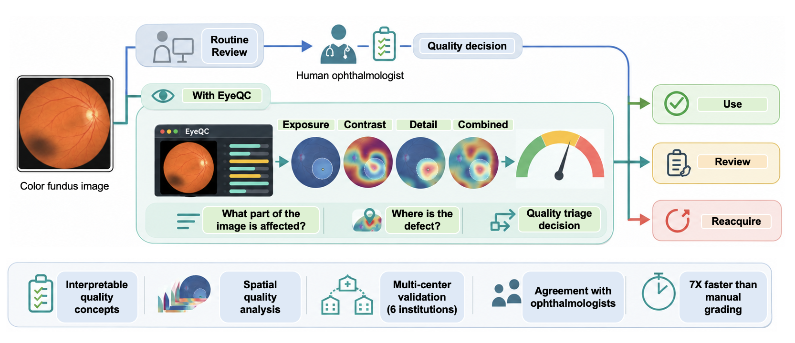
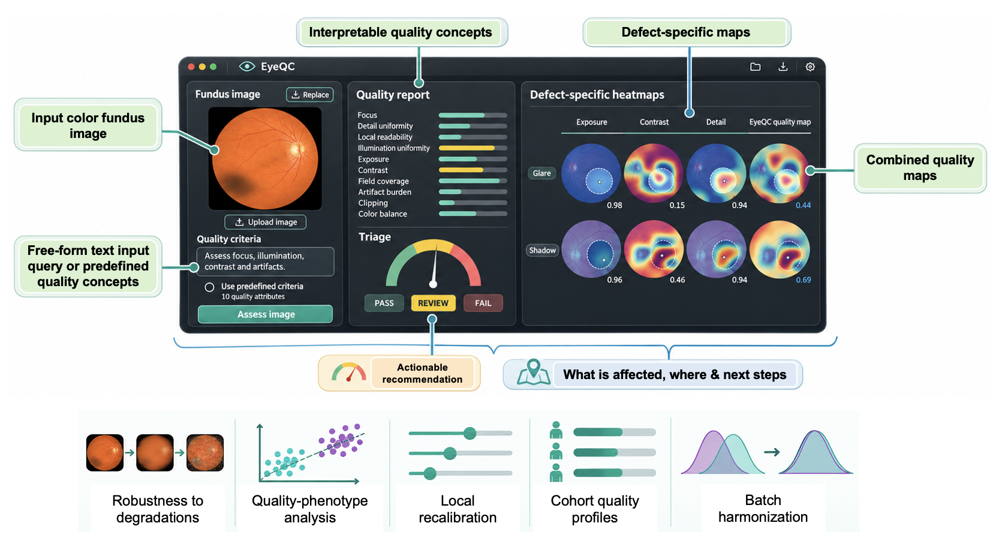
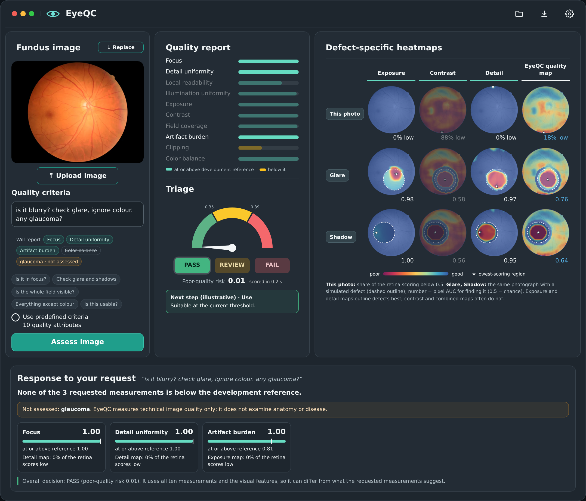

<h1 align="center">EyeQC: Concept-Augmented Retinal Fundus Image Quality Assessment</h1>

<p align="center">
  <a href="https://huggingface.co/spaces/Dharini24/EyeQC_release"></a>
  <a href="#reproducing-the-analyses"></a>
  <a href="#citation"></a>
</p>

<p align="center">
  
  
  
  
  
  
  
</p>

<p align="center">
  
</p>

EyeQC reads a colour fundus photograph and reports **what is affected, where, and what to do next**: a calibrated PASS / REVIEW / FAIL triage, ten named quality measurements, their contributions to the score, defect-specific heatmaps, and a response to a quality question typed in your own words. The ten measurements are combined with a frozen self-supervised visual representation in a single linear model, so every score can be decomposed.

This repository holds the model, code and interface behind the paper by Dharini Raghavan, Amritpal Singh, Rohan Dhamdhere, Mendel Lebowitz, Rohan Chawla, Soujanya Kaup, Nieraj Jain, Sudeshna Sil Kar, Gourav Modanwal and Anant Madabhushi.

> **Research use only.** EyeQC is not a medical device. It assesses technical image quality for standard and portable colour fundus photographs, not disease, and is not intended for ultrawide-field imaging or autonomous decisions.

## How it works

1. **Ten quality concepts** are measured with fixed image-processing rules (photograph resized to at most 640 pixels): focus, detail uniformity, local readability, illumination uniformity, exposure, contrast, field coverage, artifact burden, clipping and color balance.
2. A **frozen DINOv2 ViT-B/14** encoder produces a 768-dimensional representation of the same photograph (224 × 224 input, ImageNet normalisation).
3. One **L2-regularized logistic regression** on the 778 values, with Platt calibration, gives the poor-quality risk. Thresholds fixed on development data assign **PASS** (risk ≤ 0.3453), **FAIL** (≥ 0.3861) or **REVIEW**.
4. The calibrated log-odds split exactly into one **contribution per concept** plus one for the visual features.
5. **Defect-specific maps** evaluate the exposure, contrast and detail rules in overlapping windows to show where a measurement is low.
6. **Free-text requests** are matched to the concepts with a fixed vocabulary (no language model) and answered from their values. They never change the score or the decision.

All coefficients, scaling values and thresholds are in [`models/eyeqc_v3_model.json`](models/eyeqc_v3_model.json).

## Interactive interface

<p align="center">
  
</p>

Try it on [Hugging Face Spaces](https://huggingface.co/spaces/Dharini24/EyeQC_release), or run it locally:

```bash
pip install -r requirements-app.txt
python app/app.py                      # then open http://localhost:7860
```

<p align="center">
  
</p>

| Tab | What it does |
|---|---|
| **Overview** | Landing page with the workflow and interface figures |
| **EyeQC** | Triage, ten measurements, defect-specific heatmaps, score decomposition, free-text request and response, report download |
| **Compare** | Two photographs of the same eye: decisions, measurements and what changed the score |
| **Robustness** | Risk under nine simulated degradations; a localisation test that places a defect and asks each map to find it |
| **Cohort analysis** | Batch scoring, quality phenotypes and cohort quality profiles |
| **Harmonization** | How well measurements predict the cohort, ComBat and location-scale correction, variance and disease association |
| **Recalibration** | Validation of the frozen model on your labels; participant-separated local recalibration |
| **Reader agreement** | Weighted κ, equivalence test, Fleiss κ, Krippendorff α and ICC for your own graders |
| **Study results** | The paper's public-cohort results as interactive charts |
| **Vessels & FLAIR** | Optional third-party tools, *not part of the paper*: RRWNet artery/vein segmentation and FLAIR prompts with Grad-CAM |

- **Quality criteria** can be typed freely (for example *"is it blurry? ignore colour"*) or set to the ten predefined concepts. Questions about disease or anatomy are declared not assessed.
- The **Glare** and **Shadow** rows simulate a defect on the photograph you opened, to show how each map responds to a known region.
- The suggested next step is illustrative and has not been clinically validated.

## Results

One frozen model and fixed thresholds in every cohort.

### Discrimination and operating performance

| Cohort | Photographs | AUROC (95% CI) | PASS NPV | Poor photographs passed |
|---|---:|---|---:|---:|
| EyeQ-test (held out) | 16,249 | 0.984 (0.983–0.986) | 97.6% | 9.5% |
| DRIMDB | 194 | 1.000 (0.999–1.000) | 100.0% | 0.0% |
| FQS | 2,246 | 0.897 (0.884–0.910) | 82.6% | 25.3% |
| MSHF-CFP | 802 | 0.939 (0.921–0.954) | 87.3% | 9.9% |
| DeepDRiD (post hoc distribution shift) | 1,600 | 0.780 (0.752–0.805) | 64.0% | 41.8% |

With 100 local labels, monotone recalibration lowered DeepDRiD calibration error from 0.211 to 0.067 and poor photographs passed from 41.8% to 10.8%, while the share of all photographs passed fell from 61.2% to 26.1% (medians of 100 participant-separated splits; a different set of 100 splits can move these medians by a few percentage points). Single splits vary widely: 95% of them gave a calibration error of 0.028–0.173 and passed 1.1–31.6% of poor photographs.

### Reader study (80 photographs, three ophthalmic graders)

| Comparison | Quadratic-weighted κ |
|---|---|
| EyeQC vs each grader | 0.702–0.777 |
| Grader vs grader | 0.774–0.798 |

EyeQC's risk also identified each grader's FAIL calls (AUROC 0.952–0.971). Formal equivalence within ±0.15 was met for one of the three graders.

### Photographs of the same eye (DeepDRiD, 798 pairs)

The same decision was assigned to both photographs in 66.5% of pairs and opposite PASS and FAIL decisions in 30%. Where the reference ratings differed, the worse photograph received the higher risk in 84.0% (artifacts), 71.2% (clarity) and 78.0% (field definition) of pairs.

### Defect-specific maps

Glare, shadow and local blur were simulated on 400 gradable photographs (highest severity shown). Window size was chosen on 200 development photographs and the dense maps are reported on the other 200.

| Map | Glare | Shadow | Local blur |
|---|---:|---:|---:|
| **Exposure**, dense (pixel AUC) | **0.96** | **0.94** | 0.47 |
| **Detail**, dense (pixel AUC) | **0.91** | **0.89** | **0.81** |
| Combined, dense (pixel AUC) | 0.64 | 0.65 | 0.58 |
| Contrast, dense (pixel AUC) | 0.51 | 0.53 | 0.52 |
| Combined 6 × 6 tiles (lowest tile inside defect; chance 22%) | 96% | 95% | 40.5% |
| Detail 6 × 6 tiles (same measure) | 98% | 98% | 88% |

At low severity most maps are close to chance. All three defects reduce image detail, so the detail map does not tell which defect is present.

### Speed

Complete CPU pipeline: median 208 ms per photograph (99th percentile 272 ms). Dense maps are computed on request and take under a second more.

## Research applications

| Application | In the interface | In code |
|---|---|---|
| Robustness to degradations | *Robustness* | `eyeqc.experiments.apply_degradation` |
| Quality phenotypes | *Cohort analysis* | `eyeqc.phenotypes` |
| Cohort quality profiles | *Cohort analysis* | `eyeqc.phenotypes.cohort_profiles` |
| Local recalibration | *Recalibration* | `eyeqc.recalibration` |
| Batch harmonization | *Harmonization* | `eyeqc.batch_effects` |
| Consistency across photographs | *Compare* | `eyeqc.pairs` |
| Reader agreement | *Reader agreement* | `eyeqc.agreement` |
| Free-text requests | *EyeQC* | `eyeqc.criteria`, `eyeqc.query` |

## Quick start

```bash
git clone https://github.com/rdharini2001/EyeQC_release.git
cd EyeQC_release
pip install -r requirements.txt
pip install -e .
```

The DINOv2 weights (about 330 MB) are downloaded on first use.

```python
from eyeqc.model import load_model
from eyeqc.pipeline import read_rgb
from eyeqc.maps import quality_maps, overlay
from eyeqc.criteria import parse_criteria
from eyeqc.query import answer

result = load_model().analyze(read_rgb("photo.jpg"))
print(result["verdict"], result["risk_bad"])          # PASS / REVIEW / FAIL, calibrated risk
print(result["axis_contributions"])                   # log-odds contribution of each concept

maps = quality_maps(result["features"])               # exposure, contrast, detail, quality
picture = overlay(result["features"], maps["detail"])  # RGBA image

reply = answer(parse_criteria("is it blurry? any shadows?"), result, maps)
print(reply.headline)
```

Maps from the command line:

```bash
python -m eyeqc.maps photo.jpg              # exposure and detail maps
python -m eyeqc.maps photo.jpg --all        # all four
```

## Where the method lives

| Methods section | Code |
|---|---|
| Retinal field, ten quality concepts | [`eyeqc/core.py`](eyeqc/core.py), [`eyeqc/pipeline.py`](eyeqc/pipeline.py) (`read_rgb`) |
| DINOv2 preprocessing and embedding | [`eyeqc/backbone.py`](eyeqc/backbone.py), [`scripts/extract_embeddings.py`](scripts/extract_embeddings.py) |
| Model, calibration, thresholds | [`scripts/train_model.py`](scripts/train_model.py), [`eyeqc/development.py`](eyeqc/development.py), [`eyeqc/model.py`](eyeqc/model.py) |
| Reader study | [`eyeqc/agreement.py`](eyeqc/agreement.py), `scripts/run_reader_*.py` |
| Spatial maps | [`eyeqc/maps.py`](eyeqc/maps.py), [`scripts/run_localization_maps.py`](scripts/run_localization_maps.py) |
| Recalibration, same-eye pairs | [`eyeqc/recalibration.py`](eyeqc/recalibration.py), [`eyeqc/pairs.py`](eyeqc/pairs.py) |
| Phenotypes, cohort variation, harmonization | [`eyeqc/phenotypes.py`](eyeqc/phenotypes.py), [`eyeqc/batch_effects.py`](eyeqc/batch_effects.py) |

## Reproducing the analyses

No datasets, photographs, per-image predictions or embeddings are redistributed. Obtain the datasets from their original sources under their own terms ([EyeQ](https://github.com/HzFu/EyeQ) with EyePACS images, DRIMDB, FQS, MSHF, [DeepDRiD](https://github.com/deepdrdoc/DeepDRiD), and UK Biobank for the reader study; see below), place the manifests and images under `data_final/`, and regenerate the embeddings with `scripts/extract_embeddings.py`.

> **UK Biobank data are restricted access.** The reader study used UK Biobank photographs. This repository contains no UK Biobank photographs, participant identifiers, individual grades or reader-study result tables. Researchers can apply for access through [UK Biobank](https://www.ukbiobank.ac.uk/); the reader-study scripts run only with approved data.

| Step | Script in `scripts/` |
|---|---|
| Embeddings and model fitting | `extract_embeddings.py`, `train_model.py` |
| Cohort validation and ablation | `run_validation.py`, `run_ablation.py` |
| Cohort intervals as reported, paired model differences | `run_paper_statistics.py` |
| Reader agreement (restricted UK Biobank data) | `run_reader_agreement.py`, `run_reader_equivalence.py`, `run_reader_group_agreement.py` |
| Degradation response and map localization | `run_degradation_response.py`, `run_compound_degradations.py`, `run_localization_maps.py` |
| Local recalibration | `run_local_recalibration.py` |
| Same-eye pairs | `run_same_eye_pairs.py` |
| Cohort variation and harmonization | `run_cohort_separability.py`, `run_harmonization_retention.py`, `run_disease_association.py` |
| Concept probes, speed, sensitivity, input check | `run_concept_probes.py`, `run_throughput.py`, `run_label_definition_sensitivity.py`, `run_input_scope_check.py` |
| Calibration diagrams, determinism | `checks/` |
| Comparison methods (RETFound, AutoMorph, QuickQual, EFIQA-CP, FTHNet, HyperIQA, BRISQUE, MCF-Net) | `comparisons/`; set `EYEQC_DATASETS` and `EYEQC_EXTERNAL` (third-party code and weights) |
| Example montages | `figures/` |

The comparison, check and montage scripts are provided as used in the study with paths made configurable; they have not been re-run from this layout. Aggregate result tables for the public cohorts are in [`results/`](results/).

```bash
pip install pytest
pytest                      # includes a check that the example photographs reproduce the study's results
pytest -m "not weights"     # skip tests that need the DINOv2 download
```

## Repository layout

```
eyeqc/       concepts, model, maps, free-text requests, recalibration, agreement, pairs, phenotypes, harmonization, statistics
models/      frozen EyeQC model and the three ablation models
app/         Gradio interface, example photographs, optional third-party tools
scripts/     analysis scripts, comparison methods, checks
tests/       unit tests and reproducibility checks
results/     aggregate result tables
tools/       build_space.py assembles the Hugging Face Space
docs/        landing page (GitHub Pages)
```

## Limitations

- Validation is retrospective; the reader study has 80 photographs and there is no prospective clinical evaluation.
- Performance drops under distribution shift (DeepDRiD), where risk is under-estimated without local recalibration.
- Some defects, including local blur, haze and decentring, change the risk score inconsistently.
- Maps were evaluated on **simulated** defects only; no expert-annotated defect regions were available. Maps describe measurements and do not explain the risk score.
- The contrast and combined maps often colour large parts of dim photographs and are weak at outlining defects.
- Color balance does not work for cameras with a nearly empty blue channel (observed in DRIMDB).
- Free-text matching covers a fixed English vocabulary and has not been evaluated with users.

## Citation

```bibtex
@unpublished{raghavan_eyeqc,
  title  = {{EyeQC}: Concept-Augmented Retinal Fundus Image Quality Assessment Across Institutions and Readers},
  author = {Dharini Raghavan and Amritpal Singh and Rohan Dhamdhere and Mendel Lebowitz and Rohan Chawla and
            Soujanya Kaup and Nieraj Jain and Sudeshna Sil Kar and Gourav Modanwal and Anant Madabhushi},
  year   = {2026},
  note   = {Manuscript in preparation}
}
```

## License

EyeQC code is released under the [MIT License](LICENSE). Everything else keeps its own licence: DINOv2 (Apache 2.0), the example photographs (DeepDRiD, CC BY-SA 4.0), the adapted RRWNet code (MIT, [notice](app/third_party/eyeqc_vessel/LICENSE.rrwnet)), the RRWNet weights (**CC BY-NC 4.0, non-commercial**), FLAIR, the comparison methods and all datasets.
