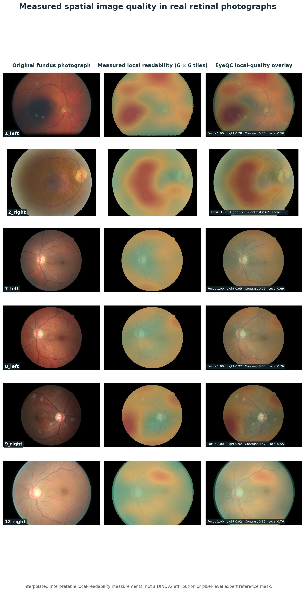

# EyeQC
### Retinal image quality, made visible.

EyeQC is a research framework for assessing the technical quality of color fundus photographs. It measures ten interpretable image properties, and the paper combines those properties with a frozen 768-dimensional DINOv2 image embedding to estimate the probability of poor image quality. The released development-derived PASS / REVIEW / FAIL cutpoints were evaluated retrospectively; they are not validated for autonomous clinical acceptance decisions.

**[Explore the existing research demo](https://huggingface.co/spaces/Dharini24/EyeQC)** · **[Original GitHub project](https://github.com/rdharini2001/EyeQC)** · **[Scientific evidence](#evidence)**



## What you can do

| Feature | Implementation | Evidence status |
| --- | --- | --- |
| Ten interpretable quality measurements | Original `eyeqc/core.py` extractor | Main manuscript |
| Local image-quality heatmap and overlay | Interpolated **actual 6 × 6 local-readability measurements** | Research visualization; not a pixel-label ground truth |
| Calibrated 778-feature model | Released EyeQC-v3 standardization, coefficients and Platt model | Contract provided; see parity note below |
| Controlled image degradations | Original nine image-transform functions, five doses | Retrospective synthetic experiment |
| Batch quality measurements | API and CSV export | Local research tool |
| Vessel maps | Optional RRWNet model, separate API | **Not part of the validated EyeQC paper model** |
| FLAIR comparison | Optional zero-shot retinal model | **Exploratory; not calibrated as FIQA** |
| Validation results | Aggregated tables from `data_final.zip` | Five evaluated cohorts, 21,091 images |

## Getting started

```bash
python -m venv .venv
source .venv/bin/activate
pip install -r requirements.txt
uvicorn portal.app:app --reload
```

Open `http://127.0.0.1:8000`. The site can measure the ten features, show real image-derived heatmaps, run controlled degradations and process batches without pretrained weights. The public demonstration is **research-only**. Do not upload personally identifying retinal files to a public demo.

### Using the frozen model

`models/eyeqc_v3_model.json` contains the **exact 778-dimensional classifier and Platt calibration parameters from the supplied results**. The extracted research code calls `eyeqc_v2.backbone`, but that module was **not present in the uploaded code archive**. We have therefore separated the mathematical classifier (`eyeqc_runtime/model.py`) from a *candidate* frozen DINOv2 image encoder. The candidate preprocess currently uses a 518×518 bicubic resize and ImageNet normalization; **do not assume these settings reproduce the published embeddings**.

By default, full calibrated predictions are disabled. To inspect the experimental end-to-end adapter after installing optional model dependencies:

```bash
pip install torch torchvision
EYEQC_ENABLE_CANDIDATE_INFERENCE=1 uvicorn portal.app:app
```

**Before a validated release**, restore the exact original backbone preprocessing module, compare embeddings on fixed example photographs, and check end-to-end predictions against the cached validation scores. Until then, this mode is explicitly labelled experimental, not clinically certified. The released model mathematical head itself is independently testable using frozen feature+embedding vectors.

## Evidence

| Dataset | Images | AUROC (95% CI) |
| --- | ---: | ---: |
| EyeQ-test (held-out same-source) | 16,249 | 0.984 (0.982–0.986) |
| DRIMDB (external) | 194 | 1.000 (0.999–1.000) |
| FQS (external) | 2,246 | 0.897 (0.885–0.910) |
| MSHF-CFP (external) | 802 | 0.939 (0.922–0.953) |
| DeepDRiD (external) | 1,600 | 0.780 (0.754–0.804) |

Those are retrospective study estimates and are **not** the performance of an unverified reconstructed runtime. The decision thresholds transferred less reliably across cohorts: in DeepDRiD, PASS NPV was 64.0%, FAIL sensitivity 56.1% and REVIEW comprised 1.8% of images. The manuscript reports an 80-image study with three graders; assistance did not form part of that study.

The archived within-eye exploratory analysis found concordance with differences in the original image-specific expert scores (artefact 83.9%, clarity 71.0%, field 78.2%) among pairs with differing annotations. These retrospective findings are not proof of reduced reacquisitions or improved clinical outcomes.

## Research structure

```text
EyeQC-Research/
├── eyeqc/                  original quality metrics and experiment functions
├── eyeqc_runtime/          testable frozen 778D scoring head; encoder adapter
├── eyeqc_vessel/           optional vessel module
├── eyeqc_flair/            optional retinal vision-language comparison
├── models/                 versioned paper model contracts
├── research/
│   ├── scripts/            original training, analysis and validation scripts
│   ├── results/            aggregate, non-patient-level study tables
│   └── figures/            original visualisation scripts
├── manuscript/             evidence-backed suggested manuscript additions
├── tests/                  smoke and mathematical-contract tests
├── portal/                   responsive research website and REST API
├── Dockerfile
└── requirements.txt
```

For checks using private cached embeddings, install `requirements-research.txt` and run `research/scripts/verify_cached_model_scores.py`. For the within-eye comparison, use `research/scripts/paired_quality_ranking.py` with your private CSV.

Some original research scripts also depend on `eyeqc_v2`, a module absent from the supplied code. They are retained for provenance, not presented as directly runnable without their original dependencies and data directories. The huge embedding caches, image-level data and source imagery are deliberately excluded from the public release.

## API

- `GET /health`, `GET /api/evidence`
- `POST /api/check` with `photo`: ten measurements, true measured tile map and overlay, scope-screening caveats; calibrated score only with the experimental encoder opt-in
- `POST /api/degradation` with `photo`, `kind`, `dose`: actual transformed image and feature-map response
- `POST /api/dose-curve` with `photo`, `kind`: five measured feature points
- `POST /api/batch` with multiple `photos`: measurements, errors and eligibility
- `POST /api/vessel`, `POST /api/flair`: optional modules that fail clearly when model weights are unavailable

Image bytes are processed in request memory, without intentional server-side persistent storage. Hosting providers, access logs and browser behavior have their own retention policies; do not describe a public server as HIPAA-compliant without appropriate security review and agreements.

## Deployment

The `Dockerfile` runs the **research workspace**, not a certified clinical decision tool. Use `docker build -t eyeqc-research . && docker run --rm -p 7860:7860 eyeqc-research`, or deploy the repository as a Docker Space on Hugging Face. A `hf_space/README.md` metadata file is included for creating a **separate new Space**; do not overwrite the existing Gradio Space without testing. Install optional models and pin their weights before enabling any model-specific endpoint. See `DEPLOYMENT.md` for steps and privacy controls.

## Transparency

The website distinguishes historical validation results from live analysis. The spatial map is a visualization of locally computed readability, **not** a pixel-level ground-truth assessment. Vessel structure and FLAIR models are optional and do not influence the reported EyeQC risk. The tool does not diagnose retinal disease and is not a substitute for clinician assessment.

## Citation

*EyeQC: A high-throughput quality control framework for multi-institutional and multi-reader standardization of retinal fundus imaging.* Manuscript in preparation; add DOI after acceptance. The additional FLAIR and RRWNet models retain their original authorship and licenses. Dataset images remain subject to their own data-use terms.
